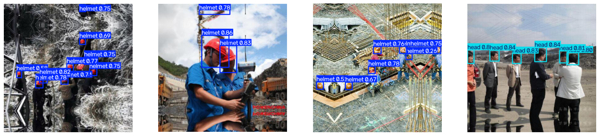
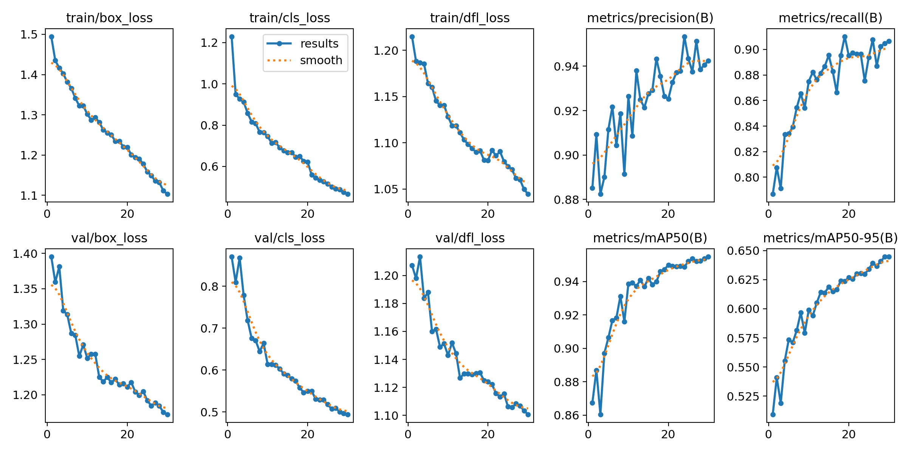
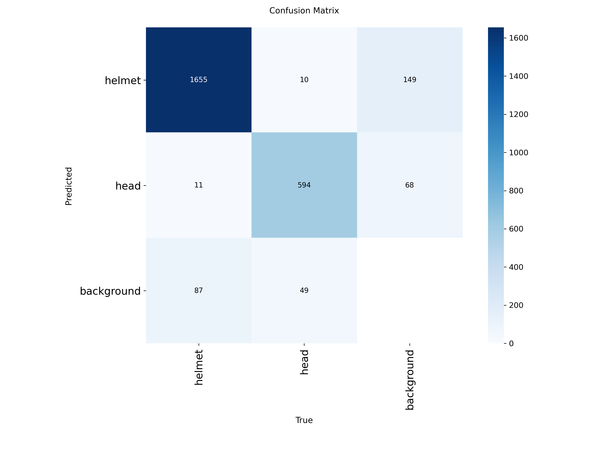

# Hard Hat Detection with YOLOv8

Detects construction workers **with** and **without** hard hats using a fine-tuned YOLOv8s model. The goal is to automate safety compliance checks from site camera images.



## Dataset
- [Kaggle Hard Hat Detection](https://www.kaggle.com/datasets/andrewmvd/hard-hat-detection): 5,000 images with Pascal VOC (XML) labels
- Classes used: `helmet` (0) and `head` (1 = no helmet)
- Dropped `person` (only 751 labels)

## Data Preparation
1. Converted Pascal VOC XML boxes (corner pixels) to YOLO format (normalized center x, center y, width, height)
2. Split 80 / 10 / 10: 4,000 train, 500 val, 500 test
3. Created `data.yaml` with paths and class names

## Training
```python
from ultralytics import YOLO
model = YOLO("yolov8s.pt")
model.train(data="data.yaml", epochs=30, imgsz=640, batch=16)
```
Trained on Google Colab (Tesla T4 GPU), about 40 minutes.

## Results (test set, unseen images)
| Class | Precision | Recall | mAP50 |
|---|---|---|---|
| All | 0.93 | 0.91 | 0.94 |
| Helmet | 0.96 | 0.90 | 0.96 |
| Head (no helmet) | 0.89 | 0.91 | 0.92 |

Inference speed: about 10 ms per image, fast enough for real-time video.




## Observations
- The `head` class scores lower, likely due to class imbalance (5,785 head vs 18,966 helmet labels)
- Some predictions have low confidence (e.g. 0.26) and need a confidence threshold in practice
- Validation and test scores are close (0.955 vs 0.942), so the model generalizes to unseen images

## Use the Model
```python
from ultralytics import YOLO
model = YOLO("weights/best.pt")
model.predict("your_image.jpg", save=True)
```

## Project Structure
```
├── hard_hat_detection.ipynb   # full pipeline
├── weights/best.pt            # trained model
└── results/                   # metrics and prediction images
```